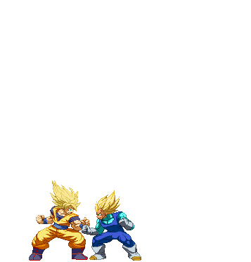

 

  

---

### 🧭 Mon Voyage · About me

🇫🇷 Étudiant en 4ᵉ année du cycle ingénieur en génie logiciel à l'Université Abderrahmane Mira de Béjaïa, je développe des applications web (PHP, JavaScript, Vue.js) et desktop (Java), de la modélisation UML à la conception de bases de données. J'utilise Jira et Git pour organiser mes projets.

🇬🇧 4th-year Software Engineering student at the University of Béjaïa, building web (PHP, JavaScript, Vue.js) and desktop (Java) applications, from UML modelling to database design. I use Jira and Git to organise my projects.

- 🏴‍☠️ **Équipage** : Université Abderrahmane Mira de Béjaïa (promo 2023)
- 🐉 **Power Level** : en constante augmentation (Java, PHP, Vue.js, SQL)
- 🥊 **Style de combat** : persévérance à la Ippo, je ne m'arrête pas avant d'avoir compris le bug
- ⚡ **Gear Second** : toujours prêt à apprendre de nouvelles technologies et à relever des défis

---

### ⚔️ Mes Compétences · Combat Style

 

  

---

### 🏴‍☠️ Mes Projets · Treasures

<table>
  <tr>
    <td width="50%">
      <h3 align="center">🛒 TechStore</h3>
      
Plateforme e-commerce complète : catalogue, panier, authentification, espace administrateur (projet scolaire, 2026)

      

        
        
        
        
        
      

    </td>
    <td width="50%">
      <h3 align="center">✈️ Gestion de Pilotage</h3>
      
<a href="https://github.com/hocineguelaache-cmd/gestion-de-pilotage">Application desktop</a> de gestion des pilotes et des vols

      

        
        
        
      

    </td>
  </tr>
</table>

---

### 🤝 Vie associative · Nakama

Membre de **ETC (ENSIA Tech Community)**, j'ai eu l'honneur de contribuer à l'organisation de :

- 🏆 ETCode 2k25
- 🏕️ BitCamp, 4ᵉ édition (28/02/2026)
- 💻 ETCode, 4ᵉ édition (22/06/2026)

*Ces certificats attestent de mes compétences en organisation et en travail d'équipe.*

---

### 📊 Mes Stats · Dragon Radar

 

---

### 🐉 Super Saiyan Mode · Never stop training

Fan animation by <b>balthazar321</b> (DeviantArt). Dragon Ball © Akira Toriyama / Shueisha / Toei Animation. Used here as fan tribute, not for commercial use.

---

### 🏆 Le Crédo de Hocine · Quotes

> *“Set sail, ship code, never stop learning.”* 夢を追え

> *“If you don't take risks, you can't create a future.”* Monkey D. Luffy, One Piece

ご訪問ありがとうございます · Merci de votre visite · Thanks for visiting 🏴‍☠️

